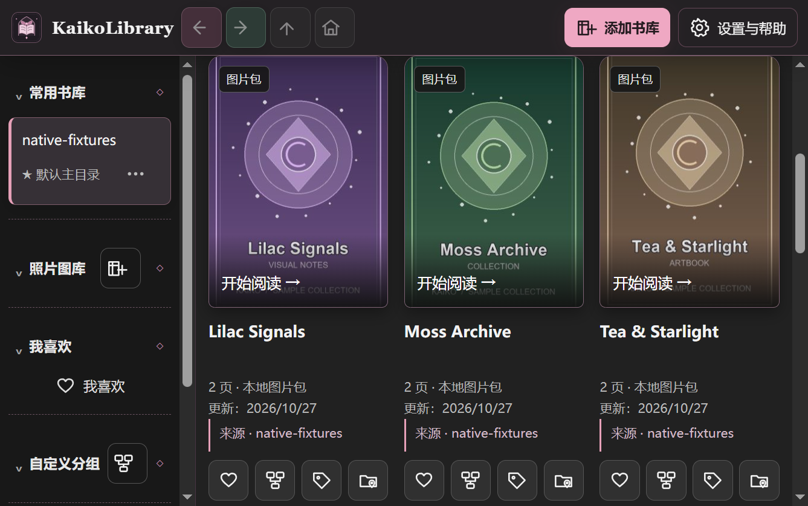
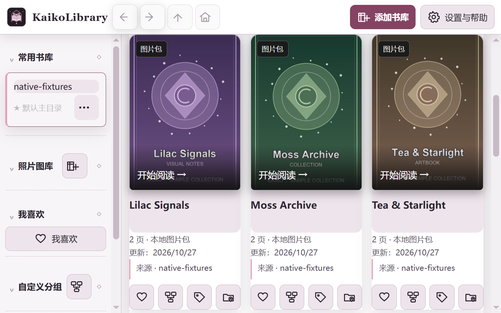
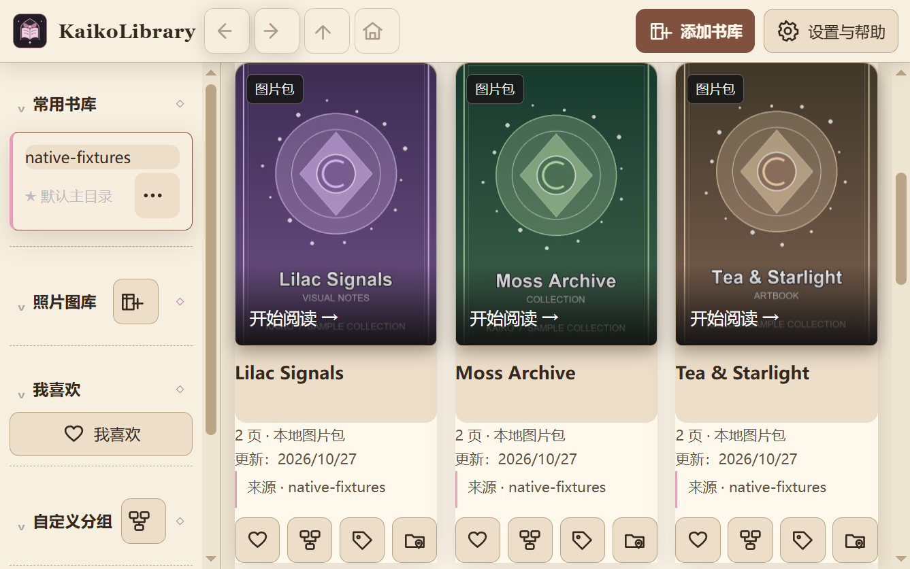
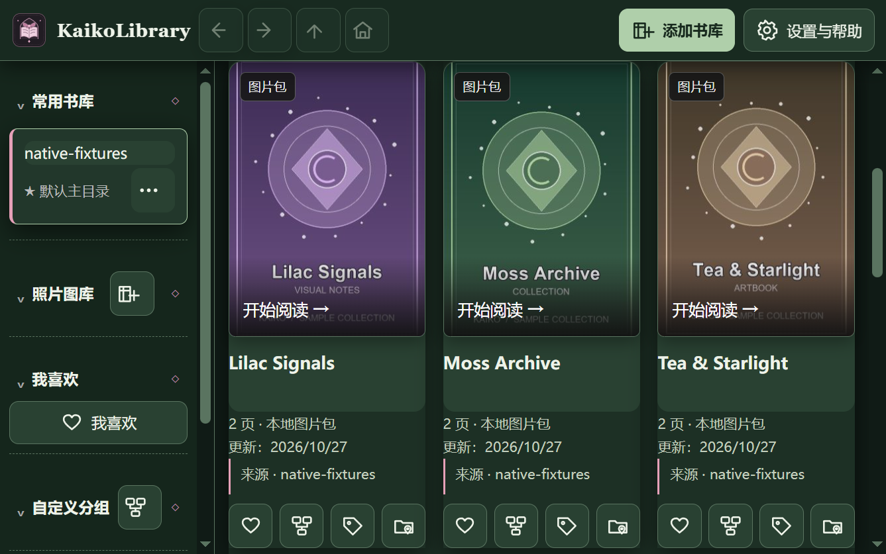

# KaikoLibrary

**あなた自身の同人誌・CG コレクションのためのライブラリ。** Windows 向けの本棚型コレクション管理・閲覧アプリです。

**Public Beta を準備中です。このリポジトリにはまだインストーラーがありません。** 最初の公開予定版は `v1.3.0-beta.1` です。公式 Release をお待ちください。第三者が配布する「公式」インストーラーにはご注意ください。

表示言語：**[简体中文](README.md) / [English](README.en.md) / 日本語**。インストール後、［設定とヘルプ］から言語とテーマを変更できます。

## 個人のコレクションを使いやすく

- **ローカル優先：** アカウント不要。元画像は選択したフォルダーに残ります。
- **本棚表示：** 画像フォルダーや通常の ZIP 画像集を表紙で閲覧し、下位フォルダーにも移動できます。
- **整理と検索：** お気に入り、タグ、グループ、検索、並べ替え、絞り込み。
- **続きから読む：** 進捗を保存し、ページ送り、拡大縮小、移動、全画面表示、サムネイルからの移動ができます。
- **3 言語・4 テーマ：** KaikoLibrary Classic、Simple Light、Warm Paper、Forest Study。

手元にある同人誌、漫画、CG 集、イラストなどの画像コレクションに適しています。成人向け作品の個人管理にも利用できます。本アプリは**作品を提供・ホスティング・配布しません**。オンラインダウンロードやクラウド同期もありません。

ほかの 3 つのテーマを見る

## インストールと動作環境

**64 ビット版 Windows 10/11** 向けで、**.NET Framework 4.8** と **Microsoft Edge WebView2 Runtime** が必要です。Runtime がない場合、セットアップ時に Microsoft のサービスへの接続が必要になる場合があります。現時点では信頼された発行者の**デジタル署名がありません**。Windows に「不明な発行元」と表示される可能性があります。将来の公式 Release からのみ入手し、チェックサムを確認してください。すべての環境での動作を保証するものではありません。[インストール案内](docs/installation.ja.md)をご覧ください。

## データとプライバシー

コレクションのアップロードは不要で、現在、能動的なテレメトリーは設計されていません。ライブラリの関連付け、お気に入り、タグ、読書進捗はローカルの WebView2 ユーザーデータに保存される場合があります。元画像は元のフォルダーに残ります。更新・アンインストールでは独立したユーザーデータ領域を保持する設計です。匿名性や暗号化保存は保証しません。**元画像とアプリデータの両方**をバックアップしてください。[プライバシー説明](PRIVACY.ja.md)をご覧ください。

## ヘルプとフィードバック

[基本ガイド](docs/user-guide.ja.md) · [よくある問題](docs/troubleshooting.ja.md) · [問題・要望を送る](https://github.com/k-kaiko/KaikoLibrary/issues)

報告前に私的なパスを削除してください。**私有の漫画、成人向け作品、ライブラリのデータベース、機密パスを含むログはアップロードしないでください。**

制作者：**Kaiko**。個人・非商用利用は無料で、ソースコードは現在非公開です。**公式ダウンロードリンク**の共有や紹介・レビュー・解説は可能です。許可なくインストーラーを改変・再配布しないでください。[最終確認待ちのライセンス草稿](LICENSE.txt)をご覧ください。第三者のコンポーネントにはそれぞれのライセンスが適用されます。
